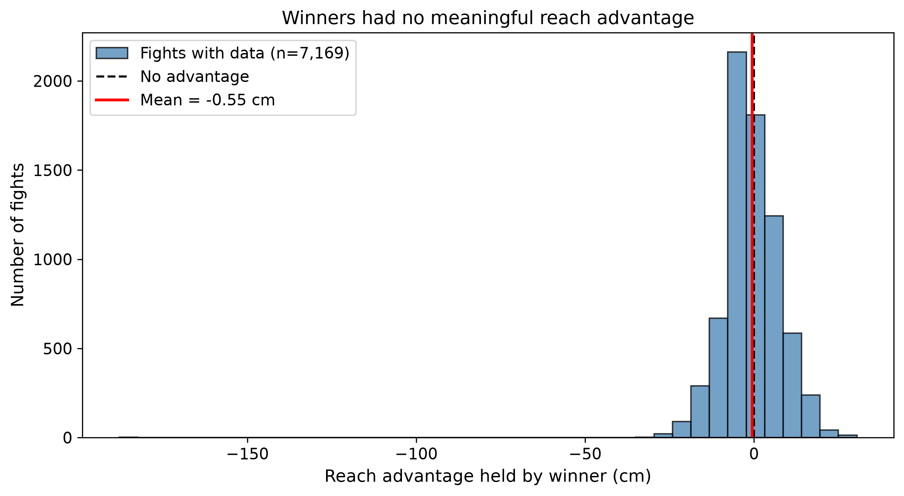

# cs418-ufc-fight-analysis
Names: Taufeeq Patel, Christian Pimentel, Uzair Azizuddin, Firas Al Halaq

## Main Findings (Narrative Analysis)

- In the 7,169 fights with reach data, the winner’s mean reach advantage was +0.55 cm (95% CI [0.34, 0.76]), but the median was 0 cm and the effect is negligible (Cohen's d = 0.06). A few rows have implausible values (a recorded reach of 0 cm, or a `reach_dif` that does not match the two fighters' reaches), so this estimate is unreliable until the reach data are checked. 

- In the 6,282 fights with pre-fight striking-accuracy data, winners had a mean accuracy advantage of 1.79% (95% CI [1.46, 2.12]), which means there's a small positive relation which varies by weight class.

- ### Finding one Analysis

The within-fight reach comparison estimated a mean winner-minus-opponent difference of −0.55 cm (n = 7,169; 95% CI [−0.76, −0.34]; *t* = −5.16, *p* = 2.5 × 10⁻⁷), while the median difference was 0 cm. The estimated average is small, and the median indicates that a typical fight had no reach difference favoring the winner. However, the largest-difference check found implausible values of −187.96 cm and −160.02 cm, which suggest a data or unit problem that could affect the mean, confidence interval, and test; verify and correct these records, then rerun the analysis before treating the estimate as reliable. The weight-class check also showed the average difference varied in direction: it was −2.01 cm in Heavyweight but +0.58 cm in Women’s Strawweight, so the overall average does not describe every division. These comparisons do not adjust for other factors such as fighter experience, and the test does not account for fighters appearing in multiple bouts.

### Finding two Analysis

The within-fight comparison of pre-fight significant-strike accuracy found a mean winner-minus-opponent advantage of 1.79 percentage points (n = 6,282; 95% CI [1.46, 2.12]; *t* = 10.55, *p* = 8.65 × 10⁻²⁶), with a median advantage of 2 percentage points. This is evidence of a small positive average association, not evidence that higher accuracy causes a win or is a strong standalone predictor. The weight-class check suggests the association is not uniform: the mean was approximately −0.03 percentage points in Light Heavyweight and +2.90 points in Bantamweight. Differences in opponent quality, experience, or other matchup characteristics could also contribute, and this analysis does not control for them. The confidence interval and test treat fights as independent, although some fighters appear in multiple bouts, which may understate uncertainty.

## Research Questions
The project will investigate UFC fight outcomes and the factors associated with winning.

Our current research questions are:

1. Do taller fighters, or fighters with longer reach or a reach advantage, win more often?
2. Are strikers or grapplers more successful — is striking accuracy or takedown accuracy more strongly tied to winning?
3. How has the baseline frequency of distance decisions vs. early knockout finishes evolved over the sport's developmental eras?

## Primary Datasets

### 1. UFC Fights Dataset
**File:** `ufc_fights.csv`
**Source:** TidyTuesday UFC Athletes and Fight Data
**Link:** https://github.com/rfordatascience/tidytuesday/blob/main/data/2026/2026-07-07/ufc_fights.csv
This dataset contains historical UFC fight information. Each row represents one UFC fight.

The dataset contains:

- 8,736 rows
- 15 columns

Relevant variables include:

- fighter names
- fight results
- event date
- location
- weight class
- method of victory
- round
- fight time
- referee

This dataset will allow us to analyze fight outcomes, methods of victory, weight classes, and changes in UFC fights over time.

### 2. UFC Stats Dataset
**File:** `ufcstats_data.csv`
**Source:** TidyTuesday UFC Athletes and Fight Data
**Link:** https://github.com/rfordatascience/tidytuesday/blob/main/data/2026/2026-07-07/ufcstats_data.csv
This dataset contains the names of all UFC fighters that have fought since the beginning of UFC. It shows their stats such as wins, losses, height, etc. Each row is one fighter's career totals.

The dataset contains:

- 4,504 rows
- 18 columns

Variables:

- wins
- losses
- draws
- height
- weight
- stance
- str_acc
- td_acc
- sub_avg

This dataset will allow us to compare fighter physical attributes and career accuracy stats against fight outcomes.

## Secondary Datasets

### 1. Ultimate UFC Dataset
**File:** `ufc-master.csv`
**Source:** Kaggle
**Link:** https://www.kaggle.com/datasets/mdabbert/ultimate-ufc-dataset?resource=download&select=ufc-master.csv
This dataset contains all the fights ranging from 2010 - current with the fighter names, their odds, their rankings, and many other goodies. Each row is one fight, with red-corner columns prefixed `R_` and blue-corner columns prefixed `B_`.

The dataset contains:

- 7,177 rows
- 118 columns

Relevant variables include:

- fighter names
- winner
- betting odds
- expected value
- weight class
- title bout flag
- pre-fight career stats (striking accuracy, takedown average, age, reach)

We can use this dataset to see trends in fighting odds vs results, find trends that can help with betting on a fighter, and also train a logistic regression model to predict the winner of an individual bout. Unlike the other files, the stats here are pre-fight snapshots (not career aggregates), which avoids outcome leakage. Adding the betting odds as a predictor lets us test whether any fighter characteristic carries information the market has not already priced in.

### 2. UFC Fighter Stats
**File:** [ufc_athletes.csv](data/ufc_athletes.csv)
**Source:** TidyTuesday UFC Athletes and Fight Data
**Link:** https://github.com/rfordatascience/tidytuesday/blob/main/data/2026/2026-07-07/ufc_athletes.csv
This dataset can be joined with `ufcstats_data.csv` since it has data such as fighting style, gym, place of birth, UFC debut date, KO/TKO wins, submission wins, and decision wins. Each row is one active fighter profile.

The dataset contains:

- 3,145 rows
- 43 columns

Relevant variables include:

- weight_class
- place_of_birth
- age
- height
- weight
- octagon_debut
- fighting_style
- trains_at
- average_fight_time

This dataset will allow us to see multiple stats of all UFC fighters and it can help determine their fighting styles.

## Exploratory Analysis
-----------------------------------------
Our exploratory phase evaluated 4,504 unique UFC athletes alongside 8,736 historical matches to identify which physical and technical attributes are associated with winning.

### Core Dataset Metadata
* **Primary Athletes Database (`ufcstats_data.csv`):** 4,504 Rows | 19 Columns
* **Historical Match Database (`ufc_fights.csv`):** 8,736 Rows | 16 Columns
* **Secondary Join Table (`ufc_athletes.csv`):** 3,145 Rows | 43 Columns (supplies `fighting_style`; joins to 65% of athletes by name)
* **Predictive Modeling Table (`ufc-master.csv`):** 7,177 Rows | 118 Columns (pre-fight snapshots, difference columns, betting odds)

### Cleaned Anomalies
Literal `"NA"` strings were converted to real nulls so they register in `null_count`. Unit suffixes and percent signs (`155 lbs.`, `42%`) were stripped and cast to numeric types. Dates were parsed into a `fight_year` field for chronological grouping. No rows were dropped during cleaning. The 1,580 fighters not matched to `ufc_athletes.csv` by name were dropped during the join step, not during cleaning.

### Revised Project Research Framework
1. Do taller fighters, or fighters with longer reach or a reach advantage, win more often?
2. Are strikers or grapplers more successful — is striking accuracy or takedown accuracy more strongly tied to winning?
3. How has the baseline frequency of distance decisions vs. early knockout finishes evolved over the sport's developmental eras?

### Original Project Research Questions
1. What fighter and fight characteristics are associated with winning UFC fights?
2. How are striking and grappling statistics associated with fight outcomes?
3. How have UFC fight characteristics and outcomes changed over time?

* **Why they changed:** Our original phrasing was too abstract to implement with the available data. The revised questions directly map to the columns we can analyze: reach/height for Q1, striking/takedown accuracy for Q2, and `method` + `date` for Q3. We also added a fight-level prediction question (below) because career stats leak the outcome and have survivorship bias — this is now our primary modeling goal.

## Data Documentation

Full documentation in [`DATASHEET.md`](DATASHEET.md).

| Dataset | Source | License |
| --- | --- | --- |
| [UFC Fights](https://github.com/rfordatascience/tidytuesday/blob/main/data/2026/2026-07-07/ufc_fights.csv) | TidyTuesday (rfordatascience/tidytuesday) | CC0 1.0 Universal |
| [UFC Stats](https://github.com/rfordatascience/tidytuesday/blob/main/data/2026/2026-07-07/ufcstats_data.csv) | TidyTuesday (rfordatascience/tidytuesday) | CC0 1.0 Universal |

**Biggest limitation:** The data only covers fighters in the UFC, so results reflect elite MMA fighters and cannot be generalized to all of the sport. Demographic coverage is partial rather than absent: age is available in `ufc_athletes.csv` (~3,145 active fighters) and in `ufc-master.csv` (`R_age`/`B_age`, post-2010 bouts only); gender is available in `ufc-master.csv`; nationality is not recorded directly, though `place_of_birth` in `ufc_athletes.csv` and event `country` in `ufc_fights.csv` serve as partial proxies. Joining the secondary files closes some gaps but introduces its own coverage limit — only 65% of fighters match by name across sources.
